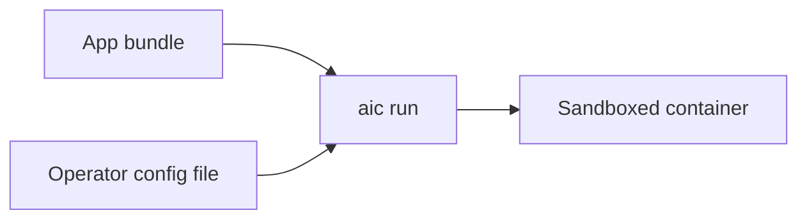

# aic Format — Specification v1 (Draft)

Status: **Draft**. Breaking changes are allowed until v1 is tagged.

The key words MUST, MUST NOT, SHOULD, and MAY are to be interpreted as in RFC 2119.

## 1. Overview

aic defines one artifact type:

| Artifact | Media type | Contains |
|---|---|---|
| **App bundle** | `application/vnd.aic.manifest.v1+json` | code, data, and per-platform runtime/packages |

The second input, the **config**, is not an artifact. The operator supplies it at run time:

- An app bundle MUST NOT contain or reference a config.
- The runtime combines the two only at run time:

  ```
  aic run --config config.json <app-ref>
  ```

The result is that an untrusted bundle can never grant itself permissions.



All objects are immutable and addressed by their digest.

## 2. Digests

- Format: `<algorithm>:<hex>`. In v1, `algorithm` MUST be `sha256` and `hex` MUST be
  exactly 64 lowercase hexadecimal characters.
- A digest is computed over the exact stored bytes of the object.
- Implementations MUST verify the digest of every object they read before using it.

## 3. Bundle Layout

On disk and on the wire:

```
<bundle>/
  manifest.json          app manifest
  blobs/sha256/<hex>     file contents and chunks
  trees/sha256/<hex>     tree objects
```

A bundle's identity is the digest of its `manifest.json`. Because objects are
content-addressed, a local store MAY keep the objects of all bundles in one shared
`blobs/` and `trees/` space.

## 4. Tree Objects

A tree object is a JSON document:

```json
{"entries":[
  {"name":"config.json","type":"file","mode":420,"size":712,"digest":"sha256:..."},
  {"name":"lib","type":"dir","digest":"sha256:..."},
  {"name":"dataset.bin","type":"file","mode":420,"size":4965799096,
   "chunks":[{"digest":"sha256:...","size":67108864}, ...]},
  {"name":"latest","type":"symlink","target":"dataset.bin"}
]}
```

Rules:
- `entries` MUST be sorted by `name` in byte order. Names MUST be unique.
- `name` MUST NOT be empty, `.`, or `..`, and MUST NOT contain `/` or NUL.
- `type` is one of `file`, `dir`, `symlink`.
  - `file`: `mode` is the permission bits (only `0644` or `0755` are allowed in v1).
    `size` is the total byte length. Exactly one of `digest` (whole file blob) or
    `chunks` MUST be present.
  - `dir`: `digest` refers to another tree object.
  - `symlink`: `target` MUST be relative and MUST NOT resolve outside the
    component root.
- **Chunking:** files larger than 64 MiB SHOULD be stored as ordered chunks
  of 64 MiB (the last chunk can be shorter). The file's bytes are the concatenation of its chunks.
- **Canonical encoding:** keys in the order shown above, omitted when not
  applicable, no insignificant whitespace, UTF-8. Two implementations MUST
  produce byte-identical tree objects for the same directory contents.
- Ownership, timestamps, xattrs, and special files are not represented.

## 5. App Manifest

```json
{
  "schemaVersion": 1,
  "mediaType": "application/vnd.aic.manifest.v1+json",
  "name": "summarizer",
  "version": "0.1.0",
  "lock": "sha256:...",
  "components": [
    {"kind":"code","name":"app","tree":"sha256:...","mount":"app","size":10240},
    {"kind":"data","name":"fixtures","tree":"sha256:...","mount":"data/fixtures","size":2048}
  ],
  "targets": {
    "darwin-arm64": {
      "components": [
        {"kind":"runtime","name":"node","tree":"sha256:...","mount":"runtime/node","size":0,
         "path":["bin"]},
        {"kind":"packages","name":"npm","tree":"sha256:...","mount":"runtime/node_modules","size":0,
         "env":{"NODE_PATH":"${AIC_MOUNT}"}}
      ]
    },
    "linux-amd64": {
      "components": [
        {"kind":"runtime","name":"node","tree":"sha256:...","mount":"runtime/node","size":0,
         "path":["bin"]},
        {"kind":"packages","name":"npm","tree":"sha256:...","mount":"runtime/node_modules","size":0,
         "env":{"NODE_PATH":"${AIC_MOUNT}"}}
      ]
    }
  },
  "entrypoint": {"cmd": ["node","app/index.js"], "env": {}, "workdir": "app"},
  "annotations": {}
}
```

Rules:
- Unknown fields MUST be rejected. In particular, `config` is not a valid field.
- `name` and component `name`s MUST match `^[a-z0-9][a-z0-9._-]{0,127}$`.
- Top-level `components` MUST only contain the shared kinds `code`, `data`.
- Target `components` MUST only contain the platform-specific kinds `runtime`, `packages`.
- Target keys MUST be `<os>-<arch>` with `os` ∈ {`darwin`,`linux`} and
  `arch` ∈ {`amd64`,`arm64`}.
- `mount` is a relative path made of segments `[A-Za-z0-9._-]+` and MUST NOT contain
  `.` or `..` segments.
- The top-level segments `workspace` and `scratch` are **reserved** for the
  runtime and MUST NOT be used.
- Within any one target, the shared mounts and that target's mounts together MUST be unique.
- Components are always mounted read-only.
- A target's only field is `components`.

### 5.1 Language-agnostic environment

The runtime has **no knowledge of programming languages**. A component describes
how it plugs into the process environment, and the runtime only applies that description:

- `path`: directories relative to the component root, prepended to `PATH`. Entries follow
  the same syntax as `mount`.
- `env`: environment variables. The token `${AIC_MOUNT}` expands to the component's
  absolute mount path. No other expansion is performed.
- Variable names MUST match `^[A-Za-z_][A-Za-z0-9_]*$`. `PATH`, `HOME`, `TMPDIR`, and
  any `AIC_*` name are reserved for the runtime and MUST NOT be set by components or
  `entrypoint.env`.
- Within any one target, a variable MUST be set by at most one component (shared or
  target). This keeps the resulting environment deterministic.

The runtime builds the process environment in this order:
1. Runtime variables: `AIC_ROOT`, `HOME`, `TMPDIR`, and a minimal system `PATH`.
2. `PATH` is prefixed with each target component's `path` entries in manifest order,
   then each shared component's.
3. Component `env`.
4. `entrypoint.env`, which overrides component `env`.

The host environment is **not** inherited.

## 6. Config (operator-supplied)

The config is a JSON file given to `aic run --config FILE`. It is **not** part of any
artifact. If no config is given, the runtime MUST apply deny-all: no network and no
writable paths beyond `$SCRATCH`.

```json
{
  "network": {"egress": ["api.openai.com:443"]},
  "filesystem": {"writable": ["$WORKSPACE/out"]},
  "maxMemory": 17179869184,
  "maxProcs": 64
}
```

- Unknown fields MUST be rejected, so a typo can never become a silent grant
  or a silently dropped restriction.
- `egress` entries are exact `host:port` pairs. Wildcards are not allowed. Connections go
  through the runtime's egress proxy. An empty list means no network access.
- `writable` paths MUST start with `$WORKSPACE` or `$SCRATCH` and MUST NOT contain `..`.
- Anything not granted is denied. Backends MUST NOT grant broader access
  than requested. Where a backend cannot enforce a field (e.g. hard memory
  limits on macOS), it MUST document the weaker guarantee.

## 7. Container Filesystem View

`aic run` takes one app bundle and an optional config. At run time, every container sees:

| Path (relative to container root) | Contents | Access |
|---|---|---|
| `<mount>` for each app component | component tree | read-only |
| `workspace/` (`$WORKSPACE`) | user-provided host dir, if any | per config |
| `scratch/` (`$SCRATCH`) | per-instance empty dir | read-write |

On Linux the container root becomes `/`. On macOS there is no root switch.
The container root is a host directory, and the runtime sets `AIC_ROOT`,
`HOME`, and `TMPDIR` to point inside it.

## 8. Project File (`aic.yaml`)

`aic.yaml` is the human-authored input to `aic lock` / `aic build`. It is not an
artifact and is never distributed. Only the exact file name `aic.yaml` is recognized.

```yaml
schemaVersion: 1
name: "summarizer"
version: "0.1.0"

toolchains:
  python:
    version: "3.12"
    requirements: requirements.txt

targets:          # platforms only: <os>-<arch>
  - darwin-arm64
  - linux-amd64

include:
  - "src/**"

entrypoint:
  cmd: [python, -m, src.main]
```

Parsers MUST accept only this strict subset of YAML 1.2:
- A single UTF-8 document, with no `---` multi-document streams.
- No anchors, aliases, or merge keys (`&`, `*`, `<<`). This prevents alias-expansion
  ("billion laughs") attacks and hidden indirection.
- No explicit tags (`!!str`, `!custom`, …).
- Duplicate keys and unknown keys MUST be rejected. Toolchain options are
  validated by their provider.
- Values are read with YAML 1.2 core-schema typing. The `yes`/`no`/`on`/`off` booleans from YAML 1.1
  are NOT booleans. Fields typed as strings (`version`, …) MUST be
  strings in the source; a number like `3.10` MUST be a validation error rather than silently becoming `3.1`.

`aic.yaml` MUST NOT contain a `config` key (see §1).

`include` is a top-level list of glob patterns, relative to the directory that holds
`aic.yaml`, naming the project files to ship. `**` matches any number of path
segments. Patterns MUST NOT be absolute or contain `..`. The matched files become
the app's platform-independent `code` component, mounted at `app/`.

### 8.1 Toolchains

`toolchains` maps a **provider name** to provider-defined options. Providers are
the only place where language knowledge lives. They run at `aic lock` / `aic build`
time and output ordinary components (`runtime`, `packages`) that declare their
`path` and `env` (§5.1). The runtime never calls a provider.

`toolchains` MAY be empty. For example, an app made only of shell scripts or
binaries listed in `include` needs no toolchain.

Built-in providers (planned):

| Provider | Options | Produces |
|---|---|---|
| `python` | `version`, `requirements` \| `pyproject` | relocatable CPython + resolved wheels |
| `node` | `version`, `lockfile` | Node.js + `node_modules` |
| `prebuilt` | `<platform>: <dir>` or `<platform>: {url, digest}` | binaries from any language (Go, Rust, C++, Zig, …) |

**External providers.** Any other name `N` resolves to an executable
`aic-toolchain-N` on `PATH`. Each call passes one JSON request on stdin and reads
one JSON response from stdout:

```json
// request
{"protocol": 1, "op": "lock", "platform": "linux-amd64",
 "projectDir": "/abs/path", "options": { ... }}

// response
{"components": [
   {"kind": "runtime", "name": "ruby", "mount": "runtime/ruby",
    "path": ["bin"], "env": {"GEM_HOME": "${AIC_MOUNT}/gems"}}
 ],
 "lock": { ... opaque, stored in aic.lock ... }}
```

- `op: "lock"` resolves the options into exact, pinned inputs, which go in the `lock` object.
- `op: "materialize"` receives the stored `lock` object and an empty `outDir`,
  and writes each component's files under `outDir/<name>/`. aic then hashes the
  result into trees.
- Materializing MUST be deterministic: the same lock object MUST produce
  identical tree digests. `aic build --verify` checks this.
- Providers run third-party code on the developer machine. Runtimes SHOULD run
  them sandboxed, with network access limited to the sources named in the lock.

## 9. Versioning

`schemaVersion` is incremented on any incompatible change. Runtimes MUST reject
manifests with a `schemaVersion` they do not support.
